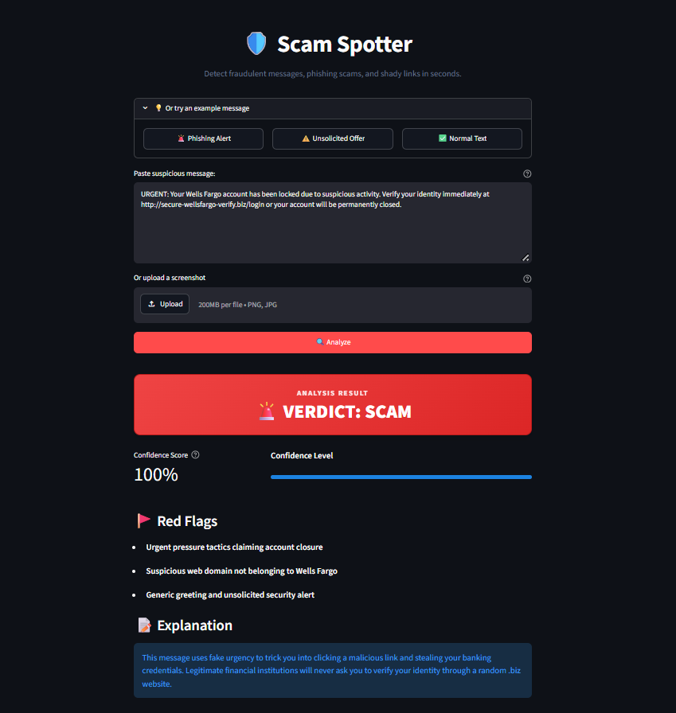
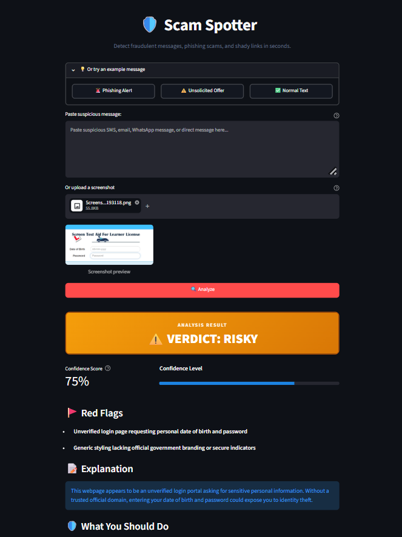
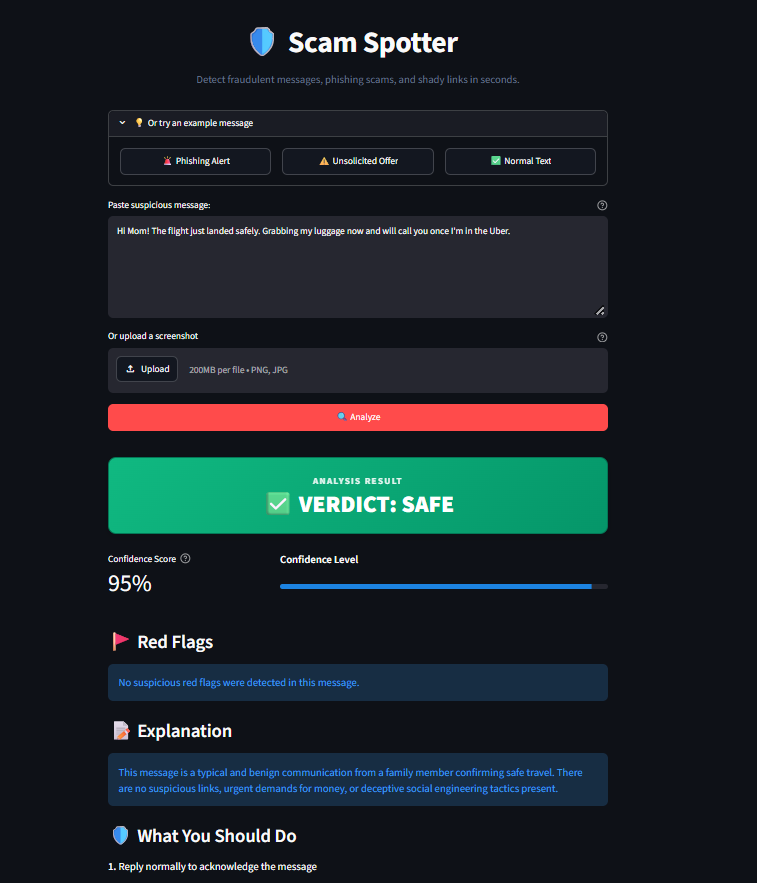

# 🛡️ Scam Spotter

> Spot fraudulent messages and phishing scams before they trick you.

## Live Demo

[https://scam-spotter.streamlit.app/](https://scam-spotter.streamlit.app/)

Scam Spotter is an AI-powered fraud-detection assistant designed to help everyday people quickly verify whether a suspicious text message, email, or screenshot is a scam.

---

## 📌 The Problem

Digital scams and phishing attacks affect every community, resulting in billions of dollars lost each year. Elderly and less tech-savvy individuals are especially vulnerable to high-pressure tactics, fake delivery notifications, spoofed bank warnings, and impersonation fraud. 

When people receive a suspicious message, they often have no simple, reliable, and judgment-free way to verify whether it is safe or a trap.

---

## 💡 The Solution

Scam Spotter provides an immediate, easy-to-use second opinion. Simply paste a message or upload a screenshot, and the app instantly delivers:

- **Clear Verdict:** A bold, color-coded status (**🚨 Scam**, **⚠️ Risky**, or **✅ Safe**).
- **Confidence Score:** A percentage rating indicating the model's certainty.
- **Red Flags:** Up to three concise points highlighting the specific tricks or manipulative tactics detected.
- **Plain-Language Explanation:** Two straightforward sentences explaining why the message is suspicious without confusing technical jargon.
- **What to Do Next:** Concrete, actionable steps to protect your personal information and finances.

---

## ✨ Features

- **Text Message Analysis:** Check SMS alerts, emails, direct messages, and chat messages.
- **Screenshot Upload Support:** Upload screenshots directly (`.png`, `.jpg`, `.jpeg` up to 5 MB) with an instant visual preview.
- **Dual Multimodal Vision & OCR:** Extracts and inspects sender details, phone numbers, and URLs directly from screenshots.
- **Guaranteed Structured JSON:** Powered by Gemini's native structured response mode and Pydantic validation for reliable output.
- **One-Click Example Presets:** Try sample phishing alerts, unsolicited offers, or safe messages with a single click.
- **Clean, Accessible UI:** Built with Streamlit for a fast, responsive, and distraction-free experience.

---

## ⚙️ How It Works

```
┌─────────────────────────┐
│ User Input              │
│ (Pasted Text or Image)  │
└────────────┬────────────┘
             │
             ▼
┌─────────────────────────┐
│ Google Gemini API       │
│ (google-genai SDK)      │
│ Specialized Fraud Model │
└────────────┬────────────┘
             │
             ▼
┌─────────────────────────┐
│ Structured JSON Schema  │
│ (Pydantic Validation)   │
└────────────┬────────────┘
             │
             ▼
┌─────────────────────────┐
│ Streamlit Result UI     │
│ (Banners, Flags, Steps) │
└─────────────────────────┘
```

1. **Input Submission:** The user pastes suspicious message text or uploads a screenshot.
2. **Gemini Analysis:** The message is sent to Google Gemini using a cybersecurity system prompt instructing the model to act as a consumer protection expert.
3. **Structured Response:** Gemini returns a strictly structured JSON response containing the verdict, confidence score, red flags, explanation, and action items.
4. **Visual Presentation:** The Streamlit dashboard parses the data and renders high-contrast verdict banners, confidence meters, and clear next steps.

---

## 📸 Screenshots

| Scam Detection | Risky Offer | Safe Message |
| :---: | :---: | :---: |
|  |  |  |

---

## 🛠️ Tech Stack

- **[Python 3.10+](https://www.python.org/):** Core programming language.
- **[Streamlit](https://streamlit.io/):** Interactive web dashboard framework.
- **[Google GenAI SDK](https://github.com/googleapis/python-genai):** Official SDK for interacting with Google Gemini models.
- **[Pydantic](https://docs.pydantic.dev/):** Data parsing, validation, and JSON schema enforcement.
- **[python-dotenv](https://github.com/theskumar/python-dotenv):** Secure environment variable management.

---

## 🚀 Local Setup

Follow these steps to run Scam Spotter locally on your machine:

### 1. Clone the Repository
```bash
git clone https://github.com/your-username/scamspotter.git
cd scamspotter
```

### 2. Create and Activate a Virtual Environment
```bash
# On Windows
python -m venv venv
venv\Scripts\activate

# On macOS/Linux
python3 -m venv venv
source venv/bin/activate
```

### 3. Install Dependencies
```bash
pip install -r requirements.txt
```

### 4. Configure Environment Variables
Copy the example environment configuration file:
```bash
# On Windows PowerShell
Copy-Item .env.example .env

# On macOS/Linux
cp .env.example .env
```

Open `.env` and configure your Google Gemini API key:
```env
GEMINI_API_KEY=your_actual_gemini_api_key_here
GEMINI_MODEL=gemini-2.5-flash
```
> You can generate a free API key at [Google AI Studio](https://aistudio.google.com/).

### 5. Launch the Application
```bash
streamlit run app.py
```
Open your browser and navigate to `http://localhost:8501`.

---

## ⚠️ Limitations & Disclaimer

- **Informational Purposes Only:** Scam Spotter is an automated advisory tool designed to provide general awareness and guidance.
- **AI Limitations:** Artificial intelligence models can occasionally produce false positives or miss sophisticated, emerging threat patterns.
- **Always Verify Independently:** Never rely exclusively on AI for critical financial or security decisions. Always verify suspicious communications through official channels, such as calling your bank using the phone number printed on the back of your card.

---

## 🔮 Future Improvements

- **Link Reputation & Domain Checks:** Real-time lookup of URLs against phishing blocklists and newly registered domain trackers.
- **Multi-Language Support:** Localized scam detection across languages and regional vernaculars.
- **Voice Input & Audio Notes:** Direct transcription and analysis of fraudulent voicemail messages and suspicious phone calls.
- **Messaging App Bots:** Instant verification via WhatsApp and Telegram bots for on-the-go checks.

---

## 📄 License

This project is licensed under the [MIT License](LICENSE). Copyright © 2026 Zakwan.
